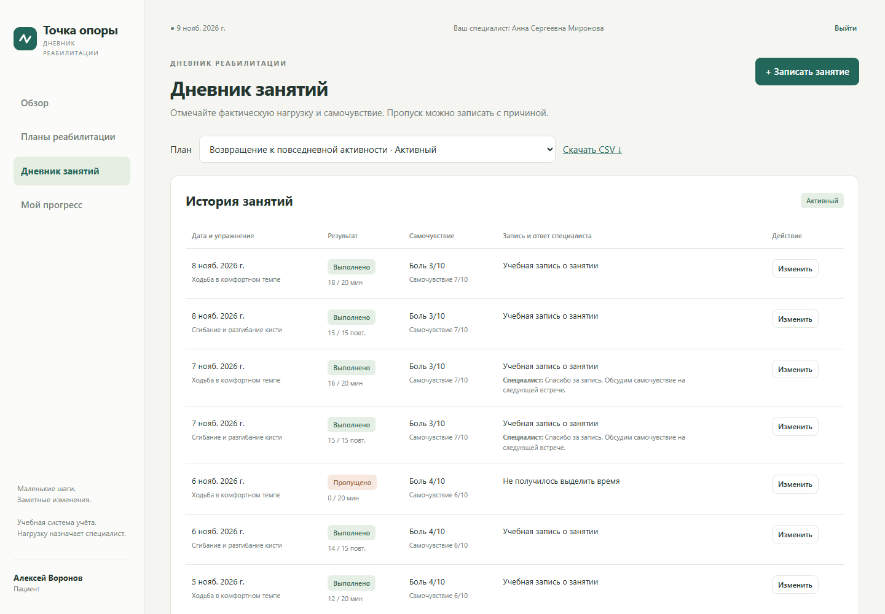

# Точка опоры

Веб-сервис для ведения дневника реабилитации после травм и инсультов. Пациент видит назначения, отмечает занятия и следит за прогрессом. Специалист составляет план и даёт обратную связь по дневнику.

Курсовой проект, тема № 19. Автор — Илья Семенютин.



## Возможности

| Роль | Что можно делать |
| --- | --- |
| Пациент | Зарегистрироваться по email, открыть план, отметить выполнение или пропуск занятия, записать нагрузку и самочувствие, посмотреть графики, скачать CSV и оставить отзыв о завершённом курсе. |
| Специалист | Работать с закреплёнными пациентами, составлять планы и назначать упражнения, активировать и завершать планы, читать дневники и отвечать на записи. |
| Администратор | Создавать аккаунты специалистов, прикреплять пациентов к специалистам, управлять карточками и просматривать журнал действий. |

В кабинете есть сообщения с индикатором непрочитанного. Пациент может написать назначенному специалисту или обратиться в техподдержку, где отвечает администратор. Новые сообщения проверяются обычными HTTP-запросами раз в пять секунд в открытой вкладке.

## Технологии

| Часть проекта | Технологии |
| --- | --- |
| Интерфейс | HTML, CSS, JavaScript без клиентских фреймворков; HTTP-запросы через Fetch API, графики в SVG |
| Сервер | Java (целевая версия 17), Spring Boot 3.5.16, Spring MVC, Bean Validation |
| Вход и доступ | Spring Security, серверные сессии, BCrypt, CSRF и проверка доступа к данным пациента |
| Хранение | Spring Data JPA, Hibernate, файловая база H2 |
| API | HTTP и JSON; springdoc-openapi 2.8.17 генерирует спецификацию OpenAPI, которую отображает Swagger UI |
| Сборка и тесты | Maven, JUnit 5, Spring MockMvc, Spring Security Test |

## Запуск на Windows

Понадобится **JDK 17 или новее**. Для сборки нужен Maven: скрипт ищет его в PATH, а затем в установленной IntelliJ IDEA. При первой сборке Maven скачивает зависимости.

Откройте PowerShell в корне репозитория и выполните:

```powershell
.\build.cmd
.\start.cmd
```

Дождитесь сообщения Started RehabApplication и откройте [приложение](http://127.0.0.1:8080/). Остановить сервер можно через **Ctrl+C**. Если в app уже лежит готовый JAR, для запуска достаточно start.cmd; после изменения исходников пересоберите проект.

На главной нажмите **«Войти»** и выберите роль в блоке **«Демонстрационный вход»**. На новой базе пациент уже имеет пример активного плана. Для самостоятельной регистрации выберите **«Регистрация»**: после первого входа у нового пациента ещё нет плана. Администратор может назначить специалиста, а специалист или администратор — создать план.

В IntelliJ IDEA можно открыть [pom.xml](pom.xml) как Maven-проект, выбрать JDK 17+ и запустить класс RehabApplication. Рабочей папкой должен быть корень репозитория.

## Как устроен проект

Приложение запускается одним Java-процессом: Spring Boot раздаёт HTML, CSS и JavaScript и принимает запросы к API на том же адресе. Например, при сохранении занятия браузер отправляет **POST /api/entries**. Контроллер принимает JSON, сервис проверяет владельца дневника, состояние плана и дату, затем репозиторий через Hibernate сохраняет запись в H2. После ответа **201 Created** браузер запрашивает обновлённые дневник и прогресс.

| Где искать | Что внутри |
| --- | --- |
| [src/main/resources/static](src/main/resources/static) | Каркас страницы, оформление и браузерная логика |
| [api](src/main/java/ru/coursework/rehab/api) | Контроллеры, входные и выходные DTO, обработка ошибок |
| [service](src/main/java/ru/coursework/rehab/service) | Правила планов, дневника и чата, расчёт прогресса |
| [repository](src/main/java/ru/coursework/rehab/repository) | Интерфейсы доступа к данным |
| [domain](src/main/java/ru/coursework/rehab/domain) | Сущности JPA: аккаунты, планы, назначения, записи и сообщения |
| [config](src/main/java/ru/coursework/rehab/config) | Настройка безопасности и демонстрационные данные |
| [src/test](src/test) | Модульные, интеграционные и конкурентный тесты |

## API и тесты

После запуска откройте [Swagger UI](http://127.0.0.1:8080/swagger-ui/index.html) или [OpenAPI JSON](http://127.0.0.1:8080/v3/api-docs). Просматривать спецификацию можно без входа. Для выполнения защищённых операций войдите через приложение в том же браузере; для изменяющих запросов нужен CSRF-токен. Маршруты и примеры описаны в [документации API](docs/API.md).

Для запуска тестов без старта сайта:

```powershell
mvn test
```

Если Maven недоступен из PowerShell, запустите в IDEA **Maven → Lifecycle → test** или выполните build.cmd, который запускает полный цикл clean verify. Набор содержит **43 теста**. Отчёты Maven сохраняются в target/surefire-reports.

## Данные и настройки

Рабочая база находится в data/rehab.mv.db. Записи сохраняются между запусками; файл базы исключён из Git. По умолчанию сервер слушает только 127.0.0.1. Порт можно изменить через переменную PORT, часовой пояс — через APP_ZONE, а путь к базе — через DB_URL. Остальные параметры находятся в [application.yml](src/main/resources/application.yml).

Подробнее: [структура кода](docs/CODE_STRUCTURE.md) · [руководство пользователя](docs/USER_GUIDE.md) · [проверенные сценарии](docs/TESTING.md).

Приложение — учебный прототип. Оно фиксирует назначения и результаты занятий; показатели прогресса отражают выполнение плана и не являются медицинской оценкой.
